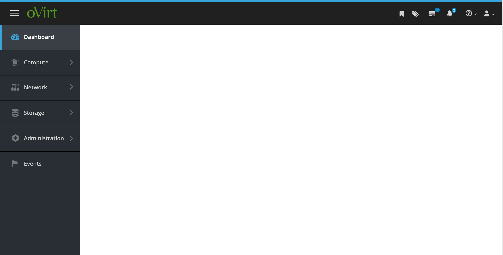

# Navigation

The oVirt UI uses the PatternFly [Vertical Navigation](https://www.patternfly.org/components/navigation/design-guidelines/#vertical-navigation) pattern.

* Selections should be visually indicated for primary navigation items.

* The primary navigation items are:
  * Dashboard
  * Compute
  * Network
  * Storage
  * Administration
  * Events
