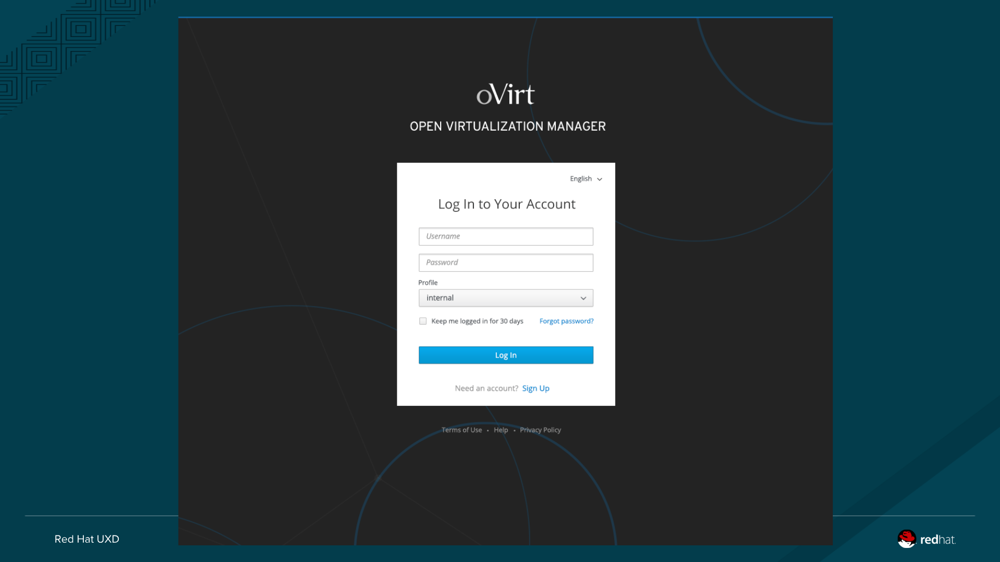
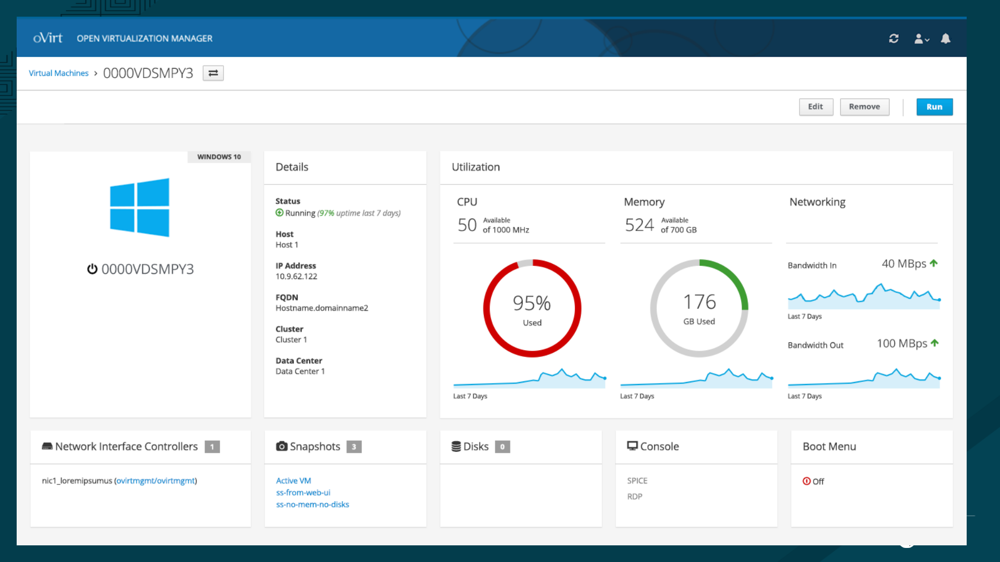
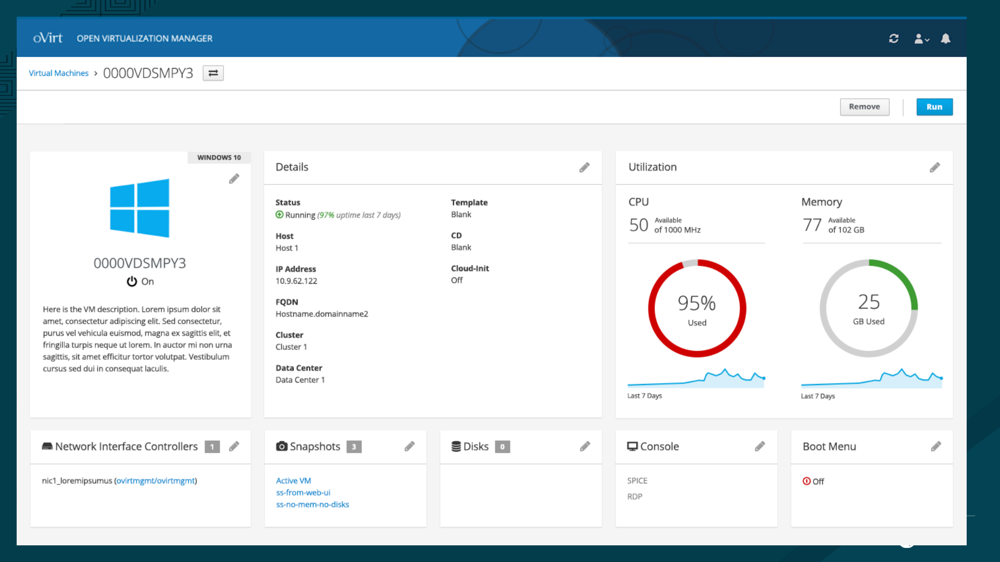
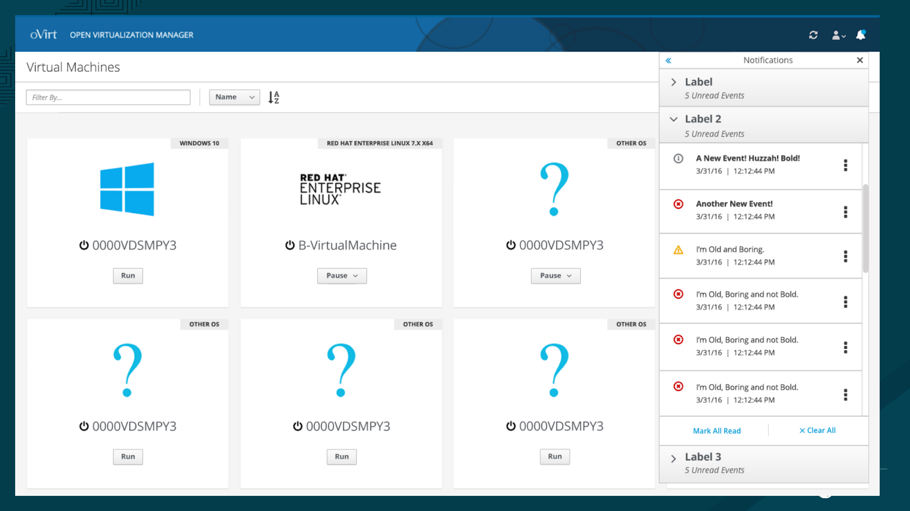
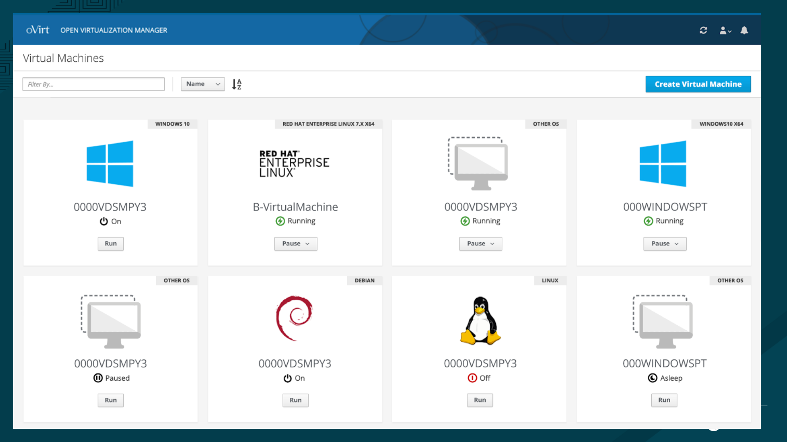
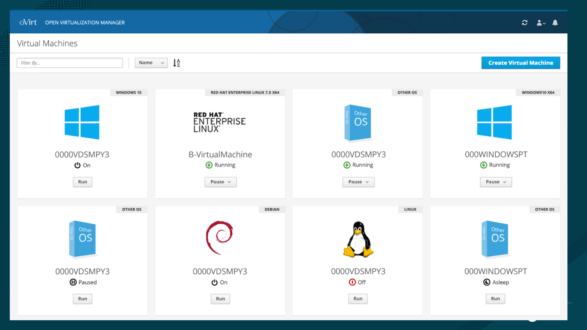
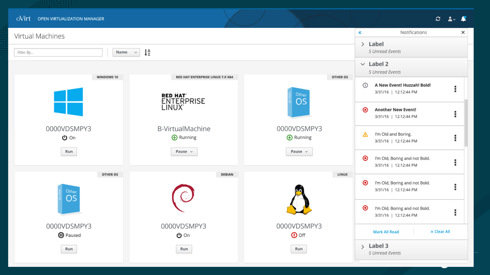
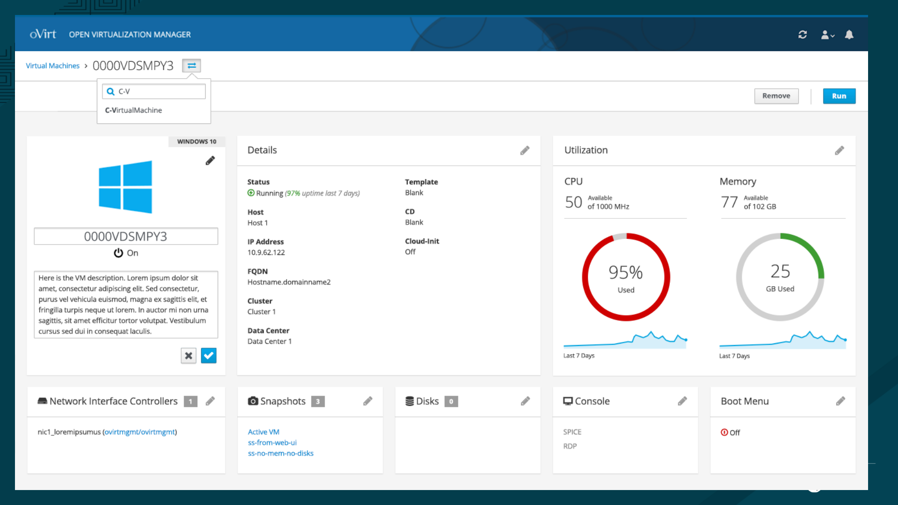

# VM Portal

We are taking a fresh look at VM Portal with the UXD team. These are the designs under review.

## Login
Login will be updated as a separate RFE from this project. It will likely use the patternfly-react component under development.
[Bug 1549486 – [RFE] update login page to match new PatternFly login design](https://bugzilla.redhat.com/show_bug.cgi?id=1549486)

## Edit VM
The Edit VM flow will transition from a dialog-ish page view to an inline-edit dashboard.

First version:

We do not have in/out network stats for VMs at the moment, only total bandwidth.

Second version:

Active edit mode:

## VM List
The page was streamlined and polished. 'Other OS' VMs have a new icon to replace the '?', which was confusing.

Old:

Machine icon:

Team prefers the 'Other OS' software icon, but will gray its color:

With the notification drawer:

VMs selector:

